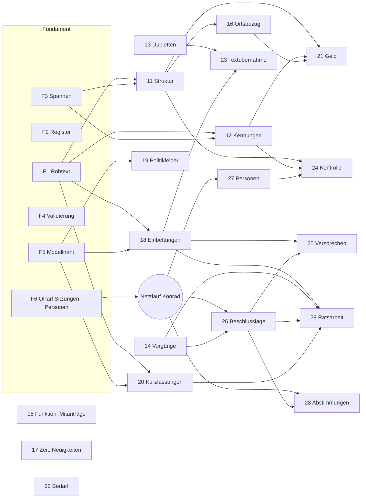

# Meta-Plan: Vorverarbeitung der Ratsdokumente, in Stufen, mit bis zu zehn Agenten

Stand 2026-11-23, Auftrag von Konrad am selben Tag: die Vorverarbeitungsideen aus dem Gespräch
dieses Tages (Struktur, Kennungen, Dubletten, Vorgänge, Ortsbezug, Zeit, Einbettungen, Politikfelder,
Zusammenfassungen, Geld, Bedarf, Textübernahme, Akteure, Beschlüsse, Abstimmungen, Anwendungen für die
Ratsarbeit) **ausprobieren, inkrementell und teilweise parallel, mit bis zu zehn gleichzeitigen
Agenten**. Begonnen am 2026-11-23 nach Konrads Antworten in § 10; Supervisor ist die Sitzung, in der
dieser Plan entstand. Zwei Antworten haben den Plan geändert: Konrad kodiert nicht selbst (§ 2.6 und
F4 beschreiben die Validierung durch Kodier-Agenten), und jeder Merge, der Code ändert, bekommt eine
eigene Version (§ 2.12).

Vorbild ist der abgeschlossene Meta-Plan [plan-ausbau-2026-10.md](plan-ausbau-2026-10.md) (acht Optionen,
Supervisor, Unteragenten, Synergiephase). Dieser Plan übernimmt dessen Rollen, Fragenprotokoll und
Merge-Regeln und ändert drei Dinge, die § 2 begründet: **jedes Vorhaben beginnt mit einer Messung statt mit
einem Plan**, die Agenten laufen in einer **Warteschlange nach Abhängigkeiten** statt in festen Wellen, und
neue Inhalte kommen auf **Unterseiten** statt auf `index.html`. Projektregeln stehen in
[../CLAUDE.md](../CLAUDE.md), der Aufbau in [architecture.md](architecture.md), die Gründe in
[decisions.md](decisions.md), der Stand in [../STATUS.md](../STATUS.md).

## 1. Ziel, Nicht-Ziele, Ausgangslage

**Ziel.** Neunzehn Vorhaben (Nummern 11 bis 29, § 11) werden je für sich ausprobiert. Jedes endet auf
genau eine von zwei Arten: als **gemessene Ablehnung** (ein Dokument mit Zahlen, warum es nicht trägt,
wie die Einbettungen in [themenmodell-2026-10.md](themenmodell-2026-10.md), § 5) oder als **Schritt der
Pipeline** mit Tests, Verträgen, Datenpaket und, wo es sich lohnt, einer Unterseite. Sechs
Fundamentbausteine (F1 bis F6, § 7) gehen voran.

**Nicht-Ziele.**

- Keine Zahl der heutigen Seite ändert sich still. Was eine bestehende Zahl berührt (Dubletten,
  Ortsbezug), kommt als zusätzliche Variante, wie die Gewichtungen von Option 06; ob sie eine Zahl
  ersetzt, entscheidet Konrad nach der Messung.
- Keine Volltexte und keine aus ihnen erzeugten Texte auf der veröffentlichten Seite ohne Konrads
  Entscheidung (§ 10, Frage 6); `workflow-ratsmitglied.md`, § 4, nennt die Gründe.
- Keine Netzläufe der Agenten über eine Stichprobe hinaus, keine externen KI-Dienste ohne Freigabe.
- Keine Privatpersonen: Personen kommen nur als Mandatsträger in öffentlicher Rolle vor, über OParl
  `person` und `membership` (Vorhaben 27), nie aus freiem Text erkannt.

**Ausgangslage, gemessen am 2026-11-23.**

| Was | Stand |
|---|---|
| PDFs lokal | Hauptperiode 19 094 (2,7 GB), 2014 bis 2020: 22 118 (3,9 GB), laufende Periode 4 090 (585 MB), Mönchengladbach 660 (233 MB), alle unter `cache_root/<profil>/pdf/` |
| Textstore | `cache_root/<profil>/text/texts.parquet`: **kleingeschrieben, ohne Zeilenumbrüche** — der Vertrag von `prep/extract.py` verlangt es (Kompatibilität mit der Arbeit). Für Abschnitte, Beträge, Tabellen und Kurzfassungen reicht das nicht: Fundament F1 |
| Verweise zwischen Drucksachen | 1 505 Titel nennen eine andere bekannte Drucksache (1 537 Verweise), in den Texten 3 630 Dokumente (5 144 Verweise); Beispiel `BV6/108/2023` beantwortet „Vorlage BV6/002/2023". Grundlage für Vorhaben 14 |
| Beratungsfolge | `consultation_organizations` bei 18 708 von 19 109 Dokumenten; `meeting`, `agendaItem`, `person`, `membership` sind nicht abgerufen: Fundament F6 |
| Dokumentarten | Beschlussvorlage 4 001, Antrag 3 321, BV-Informationsvorlage 2 699, Anfrage 2 353, BV-Beschlussvorlage 1 474, gemeinsame Arten wie „Anfrage CDU/Grüne" 126, „A+F Beschluss" 145 |
| Seite | `index.html` rund 940 KB bei einem Budget von 1,0 MB (`report.page_budget_bytes`, Punkt 50): für neue Abschnitte ist kein Platz |
| Rechner | 16 Kerne (13 erlaubt), 62 GB RAM, **eine** RTX 4090 mit 24 GB; xtraspace 203 GB frei, Primärplatte 100 GB frei |
| Lokale Modelle (ollama, Dienst läuft nicht) | `nomic-embed-text-v2-moe` (mehrsprachige Einbettungen), `qwen3.6:27b`, `gemma4`, kleinere |
| Engstellen im Code | `pipeline.build_steps` (eine Funktion von rund 950 Zeilen), `report/model.py` (2 401 Zeilen), `settings.py` (1 818 Zeilen), `defaults.toml`, `report/tables.py`: jedes Vorhaben würde sie berühren |

## 2. Gründe für die Struktur

Die Struktur folgt aus fünf Eigenschaften des Auftrags und aus dem, was der Ausbau 2026-10 gelehrt hat.
Jeder Grund nennt, was er im Plan festlegt.

**2.1 Ausprobieren heißt: die meisten Ideen sind unsicher, also zuerst messen.** Ob Kurzfassungen treu
sind, ob Einbettungen besser suchen als Wörter, ob die Texte das Abstimmungsverhalten überhaupt nennen,
weiß niemand vorher. Ein voller Plan nach dem Muster von 2026-10 (rund 500 Zeilen je Option, 5 110 Zeilen
für acht) wäre für ein verworfenes Vorhaben verlorene Arbeit. Darum hat jedes Vorhaben drei Stufen
(§ 8): **Stufe 1 misst** an einer Stichprobe gegen ein vorher festgelegtes Kriterium und schreibt das
Ergebnis samt Bauplan auf; **Stufe 2 baut** den Schritt; **Stufe 3 zeigt** ihn auf einer Unterseite.
Eine Ablehnung kostet ein Dokument und ein Messskript, keinen Schritt, keine Tests und keine Seite. Das
Projekt hat diese Form schon zweimal bewährt: die Einbettungen wurden mit Zahlen nicht gebaut
(Punkt 45), pypdf 7 wurde erst gemessen, dann entschieden (Punkte 66 bis 68).

**2.2 Die Vorhaben hängen ungleich voneinander ab, also eine Warteschlange statt fester Wellen.** Die
Dubletten brauchen nur die vorhandenen Texte, die Vorgänge nur die Drucksachennummern, die Kurzfassungen
Rohtext, Abschnitte und die GPU, der Antragserfolg Konrads Netzlauf, die Anwendungen fast alles. Feste
Wellen ließen schnelle Vorhaben auf langsame warten. Der Supervisor führt eine Warteschlange nach
Abhängigkeiten (§ 3) und füllt jeden frei werdenden Platz mit dem nächsten Vorhaben, dessen
Voraussetzungen gemerged sind. Die vier Ebenen in § 3 sind keine Termine, sondern die früheste
Startmöglichkeit.

**2.3 Parallelität scheitert an gemeinsamen Dateien, also zuerst Erweiterungspunkte.** Beim Merge der
acht Optionen endeten an rund zwölf Stellen beide Konfliktseiten mitten in einer Funktion (CLAUDE.md,
„Nach einem Rebase die `def`-Zahlen je Datei vergleichen"). Neunzehn Vorhaben würden dieselben fünf
Dateien aus § 1 berühren. Fundament F2 (§ 7) schafft darum vorab **Register**: ein Vorhaben trägt seine
Schritte, Tabellen und Unterseiten in eigenen Modulen bei und berührt die gemeinsamen Dateien nur mit
einer angehängten Zeile. Dann bleibt ein Konflikt mechanisch, und das Fundament ist ein reines
Refactoring mit bytegleicher Seite — prüfbar mit dem A/B-Bau, den Punkt 66 eingeführt hat.

**2.4 Das Seitenbudget ist voll, also Unterseiten.** `index.html` hat rund 60 KB Luft. Jede Stufe 3 bekommt
eine eigene Seite im Rahmen der Hauptseite (gleiche Farben, hell und dunkel, ohne Fremdressourcen), wie
`karte.html` und die Periodenseiten; `index.html` bekommt nur einen Linkblock „Weitere Auswertungen" aus
dem Register. Das löst zugleich die größte Konfliktstelle: eine Unterseite hat ihr eigenes Modell und
berührt `report/model.py` nicht.

**2.5 Die langsamsten Abhängigkeiten liegen außerhalb des Codes, also früh anstoßen.** Drei Dinge dauern
Stunden oder Tage und hängen nicht an Agenten: Konrads Netzlauf für Sitzungen, Tagesordnungspunkte und
Personen (der OParl-Server braucht bis zu 85 s je Seite), Konrads Kodierung von Validierungsstichproben,
und die GPU-Läufe (eine Kurzfassung je Dokument mit einem 27-B-Modell kostet Sekunden; 19 000 Dokumente
sind eine Nacht oder mehr). Darum baut F6 die Abrufe als Erstes, damit Konrad den Lauf am Anfang von
Phase 2 starten kann; darum stellt F4 die Kodierbögen bereit, bevor die erste Messung fertig ist; darum
gibt es eine GPU-Warteschlange (§ 5), die der Supervisor nachts abarbeitet.

**2.6 Eine Zahl ohne Gegenprüfung ist eine Behauptung, also Validierung als Fundament.** Grimmer und
Stewart (2013) fassen die Regel der Textanalyse in „validate, validate, validate" zusammen. Jede Messung
dieses Plans (Abschnittsgrenzen, Beträge, Politikfelder, Treue einer Kurzfassung, Ergebnis eines
Beschlusses) braucht eine geprüfte Stichprobe. Die im Ausbau zurückgestellte Option 9 („Qualität der
Operationalisierung, Annotation") wird darum zu Fundament F4: Stichprobe, Kodierbogen, Maße, Ablage.
Stufe 2 darf ohne fertige Validierung bauen; **Stufe 3 zeigt nur, was validiert ist**, und die Seite
nennt Stichprobengröße, Güte und **wer geprüft hat**.

Konrad kodiert nicht selbst (2026-11-23). Die Prüfung stützt sich darum, in dieser Reihenfolge, auf:
(1) **deterministische Prüfungen**, wo es sie gibt (eine Drucksachennummer existiert oder nicht, jede
Zahl einer Kurzfassung steht im Text oder nicht); (2) **Labels aus den Daten selbst** (Beratungsfolge,
Dokumentart, „A+F Beschluss", Verweise); (3) **von Menschen kodierte Fremddaten**, wo es sie gibt (etwa
CAP-kodierte Korpora für Vorhaben 19, mit dem Vorbehalt einer anderen Textsorte); (4) **zwei unabhängige
Kodier-Agenten** nach Codebuch und ein **Schlicht-Agent** für ihre Uneinigkeiten, mit Krippendorffs α
zwischen den beiden. Das ist kein menschlicher Goldstandard: es misst die Übereinstimmung mit einem
stärkeren Modell. Die Seite sagt das wörtlich („geprüft von zwei KI-Kodierern an *n* Dokumenten, nicht
von Menschen"), und Stufe 3 verlangt zusätzlich α ≥ 0,8 zwischen den Kodier-Agenten; darunter ist das
Codebuch zu unscharf, und das Vorhaben geht zurück in Stufe 1.

**2.7 Eine GPU, dreizehn Kerne, also Plätze nach Ressourcen.** Zehn Agenten heißen nicht zehn
Implementierer: höchstens sieben bauen oder messen gleichzeitig, mindestens drei Plätze bleiben für
Reviews, Nacharbeit und Fundament; Modellläufe über 500 Dokumente gehen nur über die GPU-Warteschlange.
Drei Vorhaben (18, 19, 20) wären sonst gleichzeitig auf einer Karte, die ein 27-B-Modell gerade trägt.

**2.8 Modelle lokal, Ergebnisse als Paket, also baut die Seite weiter ohne Netz und ohne GPU.** GitHub
Pages baut heute jeden Teil der Seite aus den Datenpaketen im Repo. Das bleibt so: ein Schritt, der ein
Modell braucht, ist wie ein Netzschritt nur mit Schalter lauffähig (`--models`), und sein Ergebnis
kommt als Parquet in ein Paket (`georep pack`). Lokale Modelle, weil die Dokumente dann den Rechner nicht
verlassen, weil es nichts je Dokument kostet und weil Modellname und Digest im Stamp den Lauf
reproduzierbar machen; ein externer Dienst nur für eine Kalibrierungsstichprobe und nur nach Freigabe
(§ 10, Frage 4).

**2.9 Lange Kontexte verlieren Einzelheiten, also Übergaben über Dateien.** Jede Stufe läuft in einem
frischen Agenten, der sein Briefing (§ 11), das Messdokument der vorigen Stufe und die lebenden Dokumente
liest. Der Stand steht in `docs/plans/README.md` (eine Zeile je Vorhaben und Stufe), nicht im Kontext
des Supervisors; ein frischer Supervisor kann jederzeit übernehmen. Für Stufe 2 und 3 desselben Vorhabens
darf derselbe Agent weiterarbeiten (SendMessage), weil die Seite den Schritt genau kennen muss.

**2.10 Ein Review, das die Zusammenfassung des Autors liest, bestätigt sie, also Review am Code.** Jeder
Merge von Stufe 2 oder 3 bekommt einen eigenen Review-Agenten, der den Diff, das Briefing und das
Messdokument bekommt, nicht den Abschlussbericht des Implementierers.

**2.11 Analysen mit Hypothesen werden vorher festgelegt.** Vier Vorhaben prüfen Thesen aus der Literatur
(17 Wahlzyklus, 21 Verteilung, 24 Kontrolle in der Kooperation, 27 Mandatstyp). Ihre Hypothesen,
Maße und Tests stehen im Messdokument, **bevor** das Ergebnis gerechnet ist; alles andere heißt auf der
Seite „explorativ". Das Projekt hat diese Lektion mit der Spalte „ohne Ausreißer" gelernt (Punkt 61).

**2.12 Klein und oft mergen, oft versionieren.** Jede Stufe wird für sich gemerged (`--no-ff`,
`nox` grün, Push), nicht ein Branch am Ende. Konflikte bleiben klein, `main` bleibt grün, und die Seite
(Staging) zeigt den Fortschritt. **Jeder Merge, der Code ändert** (Fundament, Stufe 2, Stufe 3), bekommt
eine eigene Minor-Version mit Tag und `CHANGELOG.md`-Abschnitt (Konrad, 2026-11-23: „lieber mehr
Versionen"); reine Messdokumente (Stufe 1) bekommen keine. Die Haltepunkte (§ 9) bleiben als Berichte an
Konrad, an denen er Vorhaben streichen kann.

**2.13 Zuerst die Hauptperiode, dann alle Profile.** Stufe 1 misst an der Hauptperiode (größter
Datensatz, alle PDFs lokal). Stufe 2 läuft für jedes Profil, das die Eingaben hat; Mönchengladbach ist der
Prüfstein für Stadtneutralität (keine Kürzel in den Drucksachennummern, andere Dokumentarten).

## 3. Abhängigkeiten und Ebenen



F2 und F4 stehen vor jeder Stufe 2 beziehungsweise jeder Stufe 3 und sind im Bild weggelassen.

| Ebene | Vorhaben | frühester Start von Stufe 1 | Ressource |
|---|---|---|---|
| 0 | 11, 12 (mit Rohtext als Messdatei aus Phase 0), 13, 14, 15, 17, 22 | Phase 1 | CPU; 22 kleiner Open-Data-Abruf |
| 0 | 18, 19, 20 | nach F5 | GPU |
| 1 | 16 (nach 11), 21 (nach 11, 12, 16), 23 (nach 13, 18), 24 (nach 11, 12; voll erst mit 27) | nach Stufe 2 der Zulieferer | CPU |
| 2 | 26, 27, 28 (nach Konrads Netzlauf), 25 (nach 18, 26) | Phase 3 | CPU, Netz durch Konrad |
| 3 | 29 | nach 14, 18, 20, 26 | CPU |

## 4. Regeln, die über CLAUDE.md hinausgehen

- **Branches und Worktrees sind für dieses Vorhaben freigegeben** (Konrad, 2026-11-23, § 10, Frage 1).
  Es gilt wie 2026-10: `feat/NN-name` je Vorhaben, `fund/FN-name` je Fundament, Worktrees auf xtraspace
  (§ 6), Rebase auf `main` vor jedem Merge, kein Merge mit rotem `nox`. Fundament F2 und F3 schreibt der
  Supervisor direkt auf `main`.
- **Unteragenten reden nie mit Konrad.** Fragen gehen in Abschnitt 9 ihres Messdokuments; der
  Supervisor sammelt sie in `docs/plans/fragen-2026-11.md` (Protokoll wie
  [plan-ausbau-2026-10.md](plan-ausbau-2026-10.md), § 6) und gibt sie an jedem Haltepunkt gebündelt
  weiter. Eine nicht blockierende Frage hält nichts an; es gilt die notierte Annahme.
- **Stufe 1 schreibt keinen Code unter `src/`.** Sie liefert `docs/plans/NN-name.md` (Vorlage § 12.1) und
  `docs/plans/NN-name-messung.py`, das die Zahlen des Dokuments mit `uv run python …` nachrechnet. Beides
  geht als Doku-Commit nach `main`, damit die anderen Agenten es lesen.
- **Vorab festgelegte Kriterien.** Das Kriterium jeder Stufe 1 steht in ihrem Briefing (§ 11) und darf
  nur der Supervisor vor der Messung ändern, mit Grund im Messdokument. Wer es nach dem Ergebnis ändert,
  macht aus einer Messung eine Erzählung.
- **Netz**: Agenten rufen vom OParl-Server nur Stichproben ab, höchstens rund fünf Minuten am Stück
  (F6 darf das, Frage 2); öffentliche Dokumentationsseiten lesen ist frei. Volle OParl-Abrufe sind
  Konrads Läufe nach Runbook.
- **Fremddaten sind ausdrücklich gewünscht** (Konrad, 2026-11-23, Frage 8: „unbedingt", „gerne alle
  Wahlprogramme"): Wahlprogramme und Kooperationsvereinbarungen der Ratsparteien, Datensätze des
  Open-Data-Portals, das Local Manifesto Project, das Korpus von Cherif. Agenten laden sie nur von der
  Quelle selbst (Partei, Stadt, Zenodo, Projektseite), führen jede Datei mit Quelle, Abrufdatum, Größe,
  Lizenz und SHA-256 in einem README und führen nichts aus, was sie geladen haben. Urheberrechtlich
  geschützte Texte (Wahlprogramme) bleiben auf xtraspace unter `fremddaten/`; ins Repo kommen nur
  abgeleitete Tabellen und die Quellenangaben.
- **Modelle**: Agenten dürfen ollama für Stichproben bis 500 Dokumente benutzen; alles darüber ist ein
  Auftrag an die GPU-Warteschlange (§ 5). Tests rufen nie ein Modell, sondern Fakes (F5); CI und Pages
  sehen nur Pakete.
- **Daten**: Kodierbögen mit Textausschnitten bleiben lokal auf xtraspace; ins Repo kommen nur Labels
  mit Dokument-ID (`validierung/<NN-name>/`). Neue Fremddaten nur mit Lizenz, die die Seite nennen kann,
  und mit Prüfsumme im README wie unter `context/`.
- **Seite**: `index.html` bleibt bis auf den Linkblock aus dem Register unverändert. Jede Unterseite
  bleibt unter 500 KB, ohne Fremdressourcen, hell und dunkel, mit headless Chrome angesehen (Memory-Notiz
  „site-preview-and-screenshots"), und nennt je Kennzahl ihre Validierung.
- **Bestehende Regeln gelten unverändert**: kein Stadtwort im Code, Schema-Version aus der Modulkonstante,
  nach jedem Join sortieren, Entscheidungspunkte bekommen ihre Nummer beim Merge, `STATUS.md` im selben
  Commit, kein `git add -A` im Hauptklon, Prüfschritte nie hinter einer Pipe.

## 5. Rollen und Parallelität

**Supervisor** (eine Sitzung, § 12.5): Phase 0, Fundament F2 und F3, Warteschlange und Plätze, GPU-
Warteschlange, Lesen jedes Messdokuments und Urteil „bauen / umbauen / verwerfen", Synergien
(`docs/plans/00-synergien-2026-11.md`), Fragen bündeln, Merges, Versionen, `STATUS.md`, Aufräumen. Er
implementiert sonst nichts.

**Mess-Agent** (Stufe 1, je Vorhaben einer, Opus): liest Briefing und Daten, misst, schreibt das
Messdokument mit Bauplan, kodiert keine eigene Goldstandard-Stichprobe (Rollen von F4).

**Bau-Agent** (Stufe 2 und 3, je Vorhaben einer, Opus): baut nach dem Messdokument und den Änderungen der
Synergie, im eigenen Worktree; nach dem Merge von Stufe 2 führt ihn der Supervisor per SendMessage in
Stufe 3.

**Review-Agent** (je Merge einer, Opus, Skill `code-review` auf Stufe high): bekommt Diff, Briefing,
Messdokument.

**Kodier-Agenten** (F4, je Stichprobe zwei, unabhängig, Opus): kodieren nach dem Codebuch aus dem
Messdokument, ohne die Ausgabe des zu prüfenden Verfahrens und ohne einander zu sehen. Ein
**Schlicht-Agent** entscheidet nur die Uneinigkeiten. Konrad kodiert nicht (§ 2.6, Frage 7). Dieselben
Agenten dienen als großes Modell, an dem die lokalen Modelle gemessen werden (Frage 4); ein Aufruf der
Claude-API selbst braucht einen Schlüssel, den es auf dem Rechner nicht gibt (2026-11-23).

**Konrad**: Antworten, Netzläufe, Haltepunkte (§ 9).

**Plätze.** Höchstens zehn Agenten gleichzeitig, davon höchstens sieben Mess- oder Bau-Agenten.
Mindestens drei Plätze bleiben frei für Review, Nacharbeit, Kodierung und Fundament. Rechnerlast wie
2026-10: im Alltag `uv run pytest -n 2 …`, das volle `nox` vor jedem Commit, der Supervisor drosselt
über 13 Last. **Unter Fremdlast** (am 2026-11-23 um 18:29 lag das Lastmittel bei 144, getragen von
einem anderen Projekt auf demselben Rechner) gilt für alle Agenten: `uv run nox -s lint typecheck
deps` und danach `uv run nox -s test -- -n 3` statt des vollen `nox` (die posargs überschreiben
`-n auto`), `POLARS_MAX_THREADS=4`, `OMP_NUM_THREADS=2`, Mess- und Extraktionsläufe mit
`nice -n 10`, Laufzeiten nur mit `uptime` daneben, und ein roter oder abgebrochener Lauf wird erst
mit weniger Parallelität wiederholt, bevor er als Befund zählt.

**GPU-Warteschlange.** Ein Auftrag ist ein Skript in `/media/konrad/xtraspace/georep/gpu-queue/` mit
Modell, Eingabe, Ausgabe und geschätzter Dauer (aus einer gemessenen Stichprobe). Der Supervisor startet
`ollama serve` (Frage 3) und arbeitet die Aufträge nacheinander ab, lange bevorzugt nachts; die Ausgabe
liegt im Modellcache von F5 und ist damit fortsetzbar. Zwei Modelle gleichzeitig nur, wenn sie zusammen
in 24 GB passen (Einbettung plus ein LLM tun es).

## 6. Umgebung

Wie [plan-ausbau-2026-10.md](plan-ausbau-2026-10.md), § 4, mit drei Ergänzungen.

```bash
# je Vorhaben oder Fundament, aus dem Hauptklon; NN-name wie in § 11 oder FN-name wie in § 7
git worktree add /media/konrad/xtraspace/georep/worktrees/NN-name -b feat/NN-name main
cd /media/konrad/xtraspace/georep/worktrees/NN-name
export UV_PROJECT_ENVIRONMENT=/media/konrad/xtraspace/venvs/georep-NN-name
export UV_CACHE_DIR=/media/konrad/xtraspace/uv-cache
cat > settings.local.toml <<EOT
data_root = "/media/konrad/xtraspace/georep/worktrees/NN-name/data"
cache_root = "/media/konrad/xtraspace/georep/cache"
EOT
uv sync && uv run nox && uv run georep bootstrap && uv run georep run
```

- **Eigenes Venv je Worktree**, in jedem Shell-Aufruf gesetzt: ein `uv run` mit dem Venv des Hauptklons
  biegt dessen editierbare Installation um (Memory-Notiz „uv-run-repoints-venv", zweimal passiert).
- **Messdaten** liegen gemeinsam und nur lesbar unter `/media/konrad/xtraspace/georep/messdaten/`:
  `rohtext/<profil>.parquet` aus Phase 0, später die Ausgaben der GPU-Warteschlange. Mess-Agenten lesen
  dort, statt selbst zu extrahieren.
- **Platz**: zehn Venvs rund 15 GB, Datenwurzeln je Worktree unter 1 GB, Rohtext aller vier Datensätze
  geschätzt unter 2 GB, Einbettungen der Hauptperiode in float16 rund 30 MB. xtraspace hat 203 GB frei;
  der Supervisor prüft `df -h` an jedem Haltepunkt.

## 7. Fundament

**F1 Rohtext** (Agent, `fund/F1-rohtext`). Ein zweiter Textstore neben dem kleingeschriebenen:
`cache_root/<profil>/text/rohtexte.parquet` mit `name`, `text` (Groß- und Kleinschreibung, Zeilenumbrüche,
Seitenwechsel als `\f`), `pages`, `chars`, `extractor`, `pdf_sha256`; Schritt `raw_texts` (offline, liest
die lokalen PDFs), dasselbe pypdf 7.1.0 (Punkt 67), Paket über `georep pack --raw-texts` (Frage 6:
freigegeben; das Messdokument nennt die Größe je Profil). **Abnahme**: eine Eigenschaft für jedes Dokument — der Rohtext, geplättet wie
`prep/extract.py`, ergibt genau den Text des bestehenden Stores (als hypothesis-Test über Zufallstexte und
als Prüfung über die Hauptperiode); Laufzeit je Profil gemessen. Nimmt `docs/todo.md`, Punkt 7 mit (die
Seite nennt ihren Extraktor), weil dort ohnehin ein zweiter Store zu nennen ist.

**F2 Register** (Supervisor, direkt auf `main`, je Register ein Refactoring-Commit, A/B-Bau aller Seiten
bytegleich, Golden Master grün):

1. `georep/enrich/__init__.py` mit einem Tupel von Beiträgen; ein Beitrag hat `name` und
   `steps(settings, layout, http) -> list[Step]`. `build_steps` hängt die Beiträge vor `report` ein; die
   Reihenfolge im Tupel ist die Reihenfolge der Abhängigkeiten.
2. `report/pages.py`: Register der Unterseiten (Name, Titel, Schritt `page_<name>`, Vorlage unter
   `report/templates/pages/`). Dazu wird der Rahmen aus `report.html.j2` als Basisvorlage herausgelöst,
   bei bytegleichem `index.html`. Der Linkblock „Weitere Auswertungen" auf `index.html` entsteht aus dem
   Register und fehlt ohne Unterseite.
3. `report/tables.py` nimmt Tabellen aus den Beiträgen auf (Downloads, `schema.json`, CSV).
4. Zähltests leiten ihre Zahlen weiter aus den Registern ab (wie F6 von 2026-10).

Settings bleiben, wie sie sind, mit der Anhängeregel aus `docs/plans/00-synergien.md`, § 2: je Vorhaben
ein Modell vor `class Settings`, ein Feld am Ende, ein Block am Ende von `defaults.toml` mit Kopfzeile
`# --- Vorhaben NN: <Name>`, jeder neue Schritt hinter einem Schalter, der zunächst aus ist. Bekannt und
hingenommen: jeder neue Schlüssel ändert den globalen Fingerprint, nach einem Merge laufen die
Offline-Schritte einmal neu (rund 23 s).

**F3 Spannen** (Supervisor, mit F2): ein gemeinsames Schema für alles, was eine Stelle im Text
bezeichnet — `id`, `start`, `end`, `kind`, `value`, `norm`, `section`, `extractor` — mit Vertrag
(`0 <= start < end <= len(text)`, sortiert nach `id, start`), einer Lesefunktion für den Ausschnitt und
einer Eigenschaftsprüfung. 11, 12, 14, 16 und 28 schreiben Spannen; die Kodierbögen von F4 zeigen sie an.

**F4 Validierung** (Agent, `fund/F4-validierung`): Paket `georep/validation/` mit geschichteter
Stichprobe (Seed, IDs), einem **Kodierauftrag für Agenten** (eine JSONL-Datei je Kodierer mit
Ausschnitt, hervorgehobenen Spannen und den Optionen des Codebuchs, dazu eine leere Antwortdatei; die
Ausschnitte liegen lokal unter `messdaten/kodierung/`, nie im Repo), einer Zusammenführung zweier
Kodierungen mit Liste der Uneinigkeiten für den Schlicht-Agenten, Maßen (Präzision, Recall, F1 mit
Wilson-Intervall, Cohens κ, Krippendorffs α, nDCG@k) und Ablage `validierung/<NN-name>/` mit
`labels.csv` (Dokument-ID, Kodierer A, Kodierer B, Schlichtung, Endlabel) und README (Codebuch, Modell
der Kodierer, Datum). CLI `georep validate sample|tasks|merge|score <vorhaben>`. Eine HTML-Ansicht für
Menschen ist nicht nötig, solange Konrad nicht kodiert. **Abnahme**: Maße gegen Rechnungen von Hand und
gegen scikit-learn geprüft; ein Durchlauf mit Fake-Labels von der Stichprobe bis zur Zahl.

**F5 Modellnaht** (Agent, `fund/F5-modelle`): Protokolle `Embedder` und `Generator` in `georep/ml/`,
Backend ollama über HTTP auf localhost ohne neue Abhängigkeit, Fakes in `tests/fakes.py`, ein
inhaltsadressierter Cache unter `cache_root/ml/` (Schlüssel aus Modell-Digest, Prompt-Version und SHA-256
des Textes), ein fortsetzbarer Stapellauf mit Fortschritt und Hochrechnung, Modellname, Digest und
Prompt-Version im Stamp. Schritte mit `models=True` laufen wie Netzschritte nur mit Schalter (`--models`).
**Abnahme**: Tests nur mit Fakes; ein Rauchtest über 20 Dokumente mit dem echten Backend, von Hand.

**F6 OParl: Sitzungen, Tagesordnung, Personen** (Agent, `fund/F6-oparl`): Modelle `OparlMeeting`,
`OparlAgendaItem` (mit `result`, `resolutionText`, `resolutionFile`), `OparlConsultation` (mit `meeting`,
`agendaItem`, `role`), `OparlPerson`, `OparlMembership` in `georep.oparl`; Netzschritte `meetings` und
`persons` mit `--max-pages`, `modified_since` und Trockenlauf; aufgezeichnete Antworten aus einer
Stichprobe unter `tests/fixtures/http/` (Frage 2a); ein Runbook mit der Hochrechnung aus der Stichprobe
und mit dem, was der Server **füllt** (je Feld der Anteil, wie bei den Urheberfeldern, die er nicht
füllt). **Abnahme**: alle aufgezeichneten Seiten parsen, Hochrechnung steht, Konrad kann starten.

## 8. Die drei Stufen eines Vorhabens

**Stufe 1, Messen.** Eingabe: Briefing, Daten unter `messdaten/` und `data_root`. Ausgabe:
`docs/plans/NN-name.md` nach § 12.1 und `docs/plans/NN-name-messung.py`. Die Messung nutzt eine
Stichprobe nach F4; solange F4 nicht gemerged ist, eine eigene mit festem Seed, die später übernommen
wird. **Abnahme**: Zahlen mit Datum, Skript rechnet sie nach, Urteil gegen das Kriterium mit
Unsicherheit, Bauplan für Stufe 2 und 3 mit Berührungspunkten als Dateinamen, offene Fragen mit Annahme.
Danach Haltepunkt beim Supervisor: bauen, umbauen (neue Messung, höchstens eine Runde) oder verwerfen.
Verworfene Vorhaben bleiben als Dokument und bekommen eine Zeile in `decisions.md`.

**Stufe 2, Bauen.** Schritt(e) als Beitrag nach F2, Ausgaben als Parquet mit Schlüssel `id` (eine Zeile je
Korpus-ID) oder als Spannen nach F3, Schema-Version aus der Modulkonstante, Verträge an den
Batch-Grenzen, Tests (Beispiele, hypothesis für jede Eigenschaft, die für alle Eingaben gilt), Muster im
Profil statt im Code, Lauf für jedes Profil mit den Eingaben, Paket für Modell- und Rohtextergebnisse,
`architecture.md` und `decisions.md` (Nummer beim Merge). **Abnahme**: `nox`, `pytest -m slow`,
`nox -s bench` grün im Worktree; `georep run` für alle Profile; Review ohne offenen Befund.

**Stufe 3, Zeigen.** Unterseite nach F2 (oder eine Variante in einem bestehenden Umschalter, wenn sie
nur Bytes in der Größenordnung einer Legende kostet), Tabellen im Register, Validierung auf der Seite,
Zeile im `CHANGELOG.md` unter „Unreleased", wo passend ein Schritt in `workflow-ratsmitglied.md`.
**Abnahme**: Budget, hell und dunkel, Tastatur, angesehen; Review.

**Merge-Reihenfolge innerhalb einer Ebene**: zuerst die Zulieferer (11, 12, dann 14), dann nach kleinem
Fußabdruck. Jeder Merge: Rebase, `def`-Zahlen je Datei vergleichen, Review, `nox`, `--no-ff`, Push, CI
über die Actions-REST-API, Pages-Lauf grün.

## 9. Phasen und Haltepunkte

**Phase 0, Einrichtung (Supervisor).** Einstieg nach CLAUDE.md (`main`, `nox`, `pytest -m slow` grün);
Konrads Antworten (erteilt am 2026-11-23, § 10); CLAUDE.md um die Branch-Ausnahme ergänzen; `docs/plans/README.md` um die Tabelle dieses Plans erweitern, `fragen-2026-11.md`
anlegen; **Rohtext aller vier Datensätze als Messdatei** nach `messdaten/rohtext/` (ein Skript im
Scratchpad, rund eine Stunde CPU), damit 11 und 12 nicht auf F1 warten; ollama starten und den Rauchtest
mit einem Dokument machen. **Abnahme**: Worktree-Skript läuft einmal durch, Messdaten liegen, Frage 1 ist
beantwortet.

**Phase 1, Fundament und erste Messungen.** Supervisor: F2, F3 auf `main`. Plätze: F1, F4, F5, F6 und
Stufe 1 von 14, 13, 11, 12 (acht), zwei Plätze für Reviews der Fundamente. Sobald ein Fundament gemerged
ist, rücken Stufe 1 von 15, 17, 22 und die Sammlung der Wahlprogramme für 25 nach, dann 18, 19, 20
(nach F5, GPU nacheinander). Konrad: gibt die
Netzstichprobe frei (erteilt). Kodier-Agenten laufen, sobald die erste Messung ihr Codebuch hat.
**Haltepunkt A** (nach F1 bis F6 und den Stufen 1 von 11 bis 15, 17, 22): Supervisor schreibt
`00-synergien-2026-11.md` (gemeinsame Bausteine, Konflikte, Merge-Reihenfolge, Änderungen an den
Bauplänen), legt Konrad eine Seite mit den Urteilen und den Fragen vor. Konrad startet den Netzlauf aus
F6.

**Phase 2, Bauen der Ebene 0, Messen der Ebene 1.** Bau-Agenten für die Vorhaben mit Urteil „bauen" (bis
zu sieben), Stufe 2 und 3 nacheinander; frei werdende Plätze für Stufe 1 von 16, 21, 23, 24. GPU-Läufe für
18, 19, 20 nachts. **Haltepunkt B**: Bericht an Konrad.

**Phase 3, Bauen der Ebene 1, Messen der Ebene 2.** Bau von 16, 18 bis 24 nach Urteil; Stufe 1 von 26, 27,
28 auf den Daten des Netzlaufs, 25 nach 18 und 26. **Haltepunkt C**: Bericht an Konrad.

**Phase 4, Ebene 2 und 3.** Bau von 25 bis 28; Stufe 1 bis 3 von 29, zuletzt, weil es die anderen
zusammensetzt. **Haltepunkt D**: Bericht an Konrad.

Versionen entstehen nicht an den Haltepunkten, sondern mit jedem Merge, der Code ändert (§ 2.12): ab
`v0.17.0` je Merge die nächste Minor-Version, mit Tag, `CHANGELOG.md`-Abschnitt und Versionsnummer in
`pyproject.toml`, `src/georep/__init__.py` und `uv.lock`. Laufen zwei Merges kurz nacheinander, darf der
Supervisor sie in eine Version fassen, nie mehr als zwei.

**Phase 5, Abschluss (Supervisor).** `STATUS.md`, `architecture.md`, `decisions.md`, README,
`workflow-ratsmitglied.md` (neue Wege, neue Grenzen), Literaturabschnitt (neue Einträge nach den Regeln in
`literatur.toml`), Worktrees, Venvs und Branches entfernen, dieser Plan bekommt oben „abgeschlossen am"
mit dem Stand je Vorhaben, Übergabe an Konrad.

An jedem Haltepunkt kann Konrad Vorhaben streichen, umordnen oder die Parallelität senken; was gestrichen
ist, bleibt mit seinem Messdokument liegen.

## 10. Fragen an Konrad und seine Antworten (2026-11-23)

| Nr. | Frage | Antwort | Folge für den Plan |
|---|---|---|---|
| 1 | Gilt die Branch-Ausnahme von 2026-10-11 wieder (`feat/NN-name` und `fund/FN-name` in Worktrees auf xtraspace, Merge durch den Supervisor)? | ja | § 4; CLAUDE.md trägt die Ausnahme mit Datum |
| 2 | a) Darf der F6-Agent eine Netzstichprobe von rund fünf Minuten machen (je ein, zwei Seiten `meetings`, `agendaItems`, `persons`, `memberships`)? b) Startest du danach den vollen Lauf? | ja, ja | F6 zeichnet Fixtures auf; der volle Lauf nach Haltepunkt A |
| 3 | Darf der Supervisor `ollama serve` starten und die GPU für Stapelläufe nutzen, lange Läufe nachts? Sind `qwen3.6:27b`, `gemma4` und `nomic-embed-text-v2-moe` recht? | ja | § 5, GPU-Warteschlange |
| 4 | Darf eine Kalibrierungsstichprobe (bis 200 öffentliche Dokumente) an einen externen Dienst gehen, um die lokalen Modelle einzuordnen? | ja | Auf dem Rechner gibt es keinen API-Schlüssel; die Kalibrierung übernehmen Opus-Agenten (§ 5), die ohnehin über diesen Dienst laufen. Ein Schlüssel würde nur die Stapelgröße erhöhen |
| 5 | Sollen wir die Babel Machine beantragen? | nein, „aber nachbauen?" | Vorhaben 19 bekommt einen vierten Weg: ein eigener Klassifikator auf offen lizenzierten, von Menschen CAP-kodierten Daten und Silberlabels, trainiert außerhalb des Pakets (§ 11, Vorhaben 19). Stufe 1 klärt, ob es solche Daten auf Deutsch gibt |
| 6 | Was darf veröffentlicht werden: Politikfelder, Vorgänge und ähnliche Dokumente (nur IDs), Kurzfassungen, ein Rohtextpaket im Repo wie Punkt 68? | Kurzfassungen nein, sonst ja | Vorhaben 20 bleibt lokal; Rohtextpaket (F1) und alle ID- und Klassenergebnisse dürfen ins Repo und auf die Seite |
| 7 | Kodierst du? | nein | § 2.6, § 5, F4: zwei Kodier-Agenten und ein Schlicht-Agent, die Seite sagt, dass KI geprüft hat, Stufe 3 verlangt α ≥ 0,8 |
| 8 | Fremddaten: Open Data, Wahlprogramme, Kooperationsvereinbarung, Dezernatsverteilung, Cherif-Korpus? | „ja unbedingt noch Fremddaten mit rein, gerne alle Wahlprogramme usw." | § 4: Abruf von der Quelle, README mit Lizenz und Prüfsumme, geschützte Texte nur lokal; 22 und 25 werden breiter |
| 9 | Eine Version je Haltepunkt statt einer Sammelversion? | „lieber mehr Versionen" | § 2.12: eine Version je Merge, der Code ändert |
| 10 | Reihenfolge, falls wir früher aufhören: 14, 13, 11, 12, 18, 26, 29 zuerst? | ja | Warteschlange |
| 11 | Gilt die Rechnerregel von 2026-10 (13 Kerne, RAM nach Bedarf, alle dürfen `nox` laufen lassen)? | ja | § 5 |
| 12 | Supervisor: diese Sitzung oder eine frische? | diese Sitzung | § 12.5 bleibt als Übergabe, falls ein frischer Supervisor übernehmen muss |

## 11. Briefings je Vorhaben

Jedes Briefing nennt die Frage, die Bezüge in Literatur und Praxis, die Eingaben, die Messung mit
**Kriterium**, den Bau, die Anzeige und die Ressource. Wo ein Briefing „handkodiert", „annotiert" oder
eine Präzision „an *n*" nennt, heißt das seit Frage 7: von zwei Kodier-Agenten unabhängig kodiert, die
Uneinigkeiten geschlichtet (F4). Die Literatur ist zum Lesen gedacht; was auf die
Seite kommt, prüft der Agent nach den Regeln in `report/literatur.toml`.

### 11 Struktur der Dokumente (`feat/11-struktur`, Ebene 0, CPU)

- **Frage**: Welche Teile hat ein Dokument — Kopf (Amt oder Institut, Beratungsfolge mit
  Beratungsqualität wie „Kenntnisnahme" oder „Entscheidung"), Betreff, Sachdarstellung oder Begründung,
  Beschlussvorschlag, finanzielle Auswirkungen, Klimarelevanz? Praxis: ein Vorlagenspiegel liest zuerst
  Beschlussvorschlag und Finanzen.
- **Eingaben**: Rohtext (Messdatei, später F1), Dokumentart.
- **Messung**: Katalog der Überschriften je Dokumentart aus Häufigkeiten, Abdeckung je Art; 200
  Dokumente geschichtet nach Art. **Kriterium**: richtiger Beschlussvorschlag in mindestens 90 % der
  Stichprobe, Kopffelder mit Präzision ≥ 0,95.
- **Bau**: Beitrag `sections` → Spannen `processed/dokumente_abschnitte.parquet`,
  `processed/dokumente_kopf.parquet`; Überschriften und Kopfmuster im Profil.
- **Anzeige**: keine eigene Seite; die Kopftabelle als Download. Zulieferer für 16, 20, 21, 24.

### 12 Kennungen und Beträge (`feat/12-kennungen`, Ebene 0, CPU)

- **Frage**: Bebauungsplan-Nummern, Haushalts- und Investitionsnummern, Produktgruppen, Euro-Beträge mit
  Rolle (Kosten, Zuschuss, Ertrag, Verfügungsmittel), Fristen und Termine, Rechtsgrundlagen (GO NRW,
  BauGB, StVO), Ämter und Dezernate. Drucksachennummern gehören 14.
- **Messung**: Muster je Art; Präzision an 100 Treffern je Art, Recall an 50 vollständig annotierten
  Dokumenten. **Kriterium**: Präzision ≥ 0,95 und Recall ≥ 0,85 je Art; die Rolle eines Betrags mit
  ≥ 0,8, sonst kommt nur der Betrag.
- **Bau**: Beitrag `identifiers` → Spannen `processed/kennungen.parquet` mit normalisiertem Wert.
- **Anzeige**: Download; Zulieferer für 21, 24, 29.

### 13 Dubletten und Dokumentfamilien (`feat/13-dubletten`, Ebene 0, CPU)

- **Frage**: Wie viele Dokumente sind gleich oder fast gleich — dieselbe Mitteilung an mehrere
  Bezirksvertretungen, Wiedervorlagen, Musteranträge? Wie stark ändert das die Treffer je Wahlbezirk?
  Bezug: Textübernahme (Wilkerson, Smith und Stramp 2015).
- **Eingaben**: der vorhandene Textstore genügt; startet sofort.
- **Messung**: MinHash mit LSH über Wort-Shingles (eigene typisierte Umsetzung oder eine kleine
  Bibliothek, Begründung im Dokument), Familien, Präzision an 200 Paaren; Treffer je Wahlbezirk, wenn
  jede Familie einmal zählt. **Kriterium**: Präzision ≥ 0,95; weiter, wenn mindestens 3 % der Dokumente
  in Familien liegen oder ein Wahlbezirk mindestens 5 % seiner Treffer verliert; sonst ist „es gibt kaum
  Dubletten" der Befund.
- **Bau**: Beitrag `families` → `processed/dokumentfamilien.parquet`; Gewichtsvariante `familie` in
  `analysis/weights.py` (Muster von Option 06).
- **Anzeige**: eine Zeile im Abschnitt Gewichtung (Bytes einer Tabellenzeile); Familie im Dokumentdialog.

### 14 Vorgänge (`feat/14-vorgaenge`, Ebene 0, CPU)

- **Frage**: Welche Dokumente gehören zusammen? Wie lange braucht eine Antwort, welche Anfragen sind
  unbeantwortet, was wurde aus einem Antrag? Praxis: Wiedervorlage und „gab es das schon". Bezug: die Idee
  hinter „legislative effectiveness" (Volden und Wiseman 2014), wie weit ein Antrag durch die Stufen kommt.
- **Eingaben**: Drucksachennummern in Titel und Text (Zahlen in § 1), Beratungsfolge, Dokumentart, Datum.
- **Messung**: Verweisgraph, Komponenten, Größenverteilung; typisierte Paare nach Art und Datum (Anfrage →
  Antwort oder „A+F Beschluss", Antrag → Vorlage oder Mitteilung, Vorlage → Änderungsantrag);
  Antwortzeiten. **Kriterium**: Präzision der Kanten ≥ 0,95 an 150; weiter, wenn mindestens 30 % der
  Anfragen eine Antwort finden.
- **Bau**: Beitrag `procedures` → `processed/vorgaenge.parquet` (`id`, `vorgang`, `rolle`),
  `processed/vorgang_kanten.parquet`, `processed/antwortzeiten.parquet`; das Nummernmuster im Profil
  (Mönchengladbach trägt keine Kürzel).
- **Anzeige**: Unterseite `vorgaenge.html` (Antwortzeiten je Gremium und Fraktion, älteste offene
  Anfragen, Vorgang im Dokumentdialog). 26 erweitert sie später.

### 15 Dokumentfunktion und gemeinsame Anträge (`feat/15-funktion`, Ebene 0, CPU)

- **Frage**: Kontrolle, Information, Initiative, Symbolpolitik (Resolution), Vollzug — welche Fraktion
  nutzt welches Instrument? Wer stellt mit wem gemeinsam Anträge, innerhalb der Mehrheit und über
  Lagergrenzen? Bezug: Konkordanz- gegen Konkurrenzdemokratie (Holtkamp 2008).
- **Eingaben**: Dokumentart (gemeinsame Arten wie „Anfrage CDU/Grüne"), Urheber aus `parties`,
  Titelmuster; drei Düsseldorfer Perioden.
- **Messung**: Regelwerk, Abdeckung, κ gegen 150 handkodierte Dokumente; Netz der Mitantragsteller je
  Periode. **Kriterium**: κ ≥ 0,7, Restklasse ≤ 10 %.
- **Bau**: Beitrag `functions` → `processed/dokumente_funktion.parquet`, `processed/mitantraege.parquet`;
  liest `analysis/parties.py`, ändert es nicht.
- **Anzeige**: legt die Unterseite `akteure.html` an; 24, 27, 28 erweitern sie nacheinander.

### 16 Ortsbezug verfeinern (`feat/16-ortsbezug`, Ebene 1, CPU, kleiner Open-Data-Abruf)

- **Frage**: Handelt ein Dokument von einem Ort oder erwähnt es ihn nur? Lassen sich Hausnummern und
  Flächen (Geltungsbereiche von Bebauungsplänen, Schulen, Kitas, Haltestellen) verorten? Bezug: Nyhuis
  u. a. 2025 und Harmening u. a. 2025 (beide im Literaturabschnitt).
- **Eingaben**: Index, Abschnitte aus 11, Rohtext, Flächendaten des Portals (Lizenz je Quelle).
- **Messung**: Stelle des Treffers (Titel, Betreff, Beschlussvorschlag, Rest) als Merkmal; 200 Paare
  (Dokument, Wahlbezirk) handkodiert „handelt von / erwähnt"; Abdeckung der Hausnummern; Bestand des
  Portals. **Kriterium**: F1 der Regel ≥ 0,8; Hausnummern nur, wenn ≥ 80 % verortbar sind.
- **Bau**: Gewichtsvariante `ortsbezug`; neue Begriffe aus Flächen hinter einem Schalter, der aus ist
  (er würde sonst die Treffer ändern, wie `city_facilities`).
- **Anzeige**: eine Variante im Kartenumschalter, wenn sie in die Luft des Budgets passt, sonst
  `orte.html`.

### 17 Zeit und Neuigkeiten (`feat/17-zeit`, Ebene 0, CPU)

- **Frage**: Gibt es einen Wahlzyklus (mehr Anfragen vor der Wahl), einen Haushaltsrhythmus, Spuren
  von Ereignissen? Wie viel bundespolitisches Vokabular steht in den Dokumenten, und wächst es? Bezug: der
  Folgeaufsatz zu LocalView in Publius (2025) zur Nationalisierung kommunaler Debatten. Praxis:
  Neuigkeiten je Wahlbezirk statt Nachsehen („keine Benachrichtigung", `workflow-ratsmitglied.md`, § 4).
- **Eingaben**: Korpus der drei Düsseldorfer Profile, Schritt `timeline`.
- **Messung**: **vorab festgelegte Hypothesen** mit Test; ein Lexikon bundespolitischer Begriffe mit
  Präzision ≥ 0,9 an 100 Treffern; ein Atom-Feed je Wahlbezirk der laufenden Periode, gegen das Schema
  geprüft. **Kriterium**: Lexikon erreicht die Präzision; Feeds gültig.
- **Bau**: Beiträge `cycles` und `feeds` (`site/feeds/<wahlbezirk>.xml`).
- **Anzeige**: Unterseite `zeit.html`, Feed-Links auf der Seite der laufenden Periode.

### 18 Einbettungen, Ähnlichkeit, semantische Suche (`feat/18-einbettungen`, Ebene 0, GPU)

- **Frage**: Findet eine Suche nach Bedeutung, was die Wortsuche nicht findet (wer heute „Radverkehr"
  sucht, findet nichts)? Welche Dokumente und Vorgänge ähneln einander? Tragen Cluster über Einbettungen
  besser als das NMF-Modell? Die Ablehnung von 2026-10 war eine Kostenrechnung auf der CPU; die GPU
  ändert sie.
- **Eingaben**: Rohtext, F5 (`nomic-embed-text-v2-moe`), optional Abschnitte aus 11 zum Zerteilen.
- **Messung**: 50 Suchfragen aus der Ratsarbeit mit Relevanzurteilen der Kodier-Agenten über die
  gepoolten Treffer aller Verfahren (F4); nDCG@10 für Einbettung,
  BM25 und beide gemischt; Präzision@5 der ähnlichen Dokumente an 50 Ankern; Laufzeit je Dokument.
  **Kriterium**: Einbettung oder Mischung schlägt BM25 um mindestens 0,05 nDCG@10, Präzision@5 ≥ 0,7.
- **Bau**: Beiträge `embeddings` (`models=True`, Ausgabe float16 als Paket) und `neighbors` →
  `processed/aehnliche_dokumente.parquet` (zehn IDs je Dokument); CLI `georep suche "<frage>"` lokal.
- **Anzeige**: „ähnliche Dokumente" im Dokumentdialog, nachgeladen. Eine freie semantische Suche auf
  der statischen Seite bräuchte ein Modell im Browser oder einen Server; das Messdokument beziffert beides.

### 19 Politikfelder nach dem Comparative Agendas Project (`feat/19-politikfelder`, Ebene 0, GPU)

- **Frage**: Welches der 21 CAP-Hauptthemen trägt ein Dokument? Damit wird Aufmerksamkeit vergleichbar
  mit Landtag, Bundestag und anderen Städten (Baumgartner und Jones).
- **Eingaben**: Rohtext, F5, der Ausschussklassifikator (`committees`) als Vergleich.
- **Messung**: 300 nach CAP-Codebuch kodierte Dokumente (Kodier-Agenten, F4); dazu, wenn es sie gibt,
  von Menschen CAP-kodierte deutsche Texte als zweite Prüfung. Drei Wege: lokales LLM mit dem Codebuch
  im Prompt; Abbildung Ausschuss → CAP mit Klassifikator; **Nachbau der Babel Machine** (Frage 5): ein
  eigener Klassifikator, trainiert auf offen lizenzierten, von Menschen kodierten CAP-Daten (das
  Messdokument prüft Bestand und Lizenz je Datensatz) und auf Silberlabels des lokalen LLM, Training mit
  der GPU in einem eigenen Venv außerhalb des Pakets (die Abhängigkeiten eines Trainings kommen nicht in
  `uv.lock`), ins Repo nur das Trainingsskript, die Datenquellen und die Labels. Die Babel Machine
  selbst wird nicht benutzt. **Kriterium**: Makro-F1 ≥ 0,7 und besser als die Ausschussabbildung.
- **Bau**: Beitrag `policy_areas` → `processed/politikfelder.parquet` (Paket).
- **Anzeige**: Unterseite `themen.html` (Politikfeld je Periode, Partei, Wahlbezirk).

### 20 Kurzfassungen (`feat/20-kurzfassungen`, Ebene 0, GPU, der größte Rechenposten)

- **Frage**: Zwei, drei Sätze je Dokument und je Vorgang; was ist neu gegenüber der vorigen Fassung?
  Praxis: Vorlagenspiegel. Bezug: MeetingBank (Hu u. a. 2023).
- **Eingaben**: Rohtext, Abschnitte aus 11, F5 (`qwen3.6:27b` oder `gemma4`).
- **Messung**: 200 Dokumente; eine **deterministische Treueprüfung** (jede Zahl, jedes Datum, jede
  Drucksachennummer und jeder Eigenname der Kurzfassung steht im Text) und eine Bewertung von 50 durch
  zwei Kodier-Agenten auf einer Skala von 1 bis 5, gegen eine Kurzfassung desselben Dokuments durch einen
  Opus-Agenten als Maßstab; Durchsatz auf der 4090 und daraus die Hochrechnung je Periode.
  **Kriterium**: ≥ 98 % ohne unbelegte Angabe, Median ≥ 4; die Hochrechnung entscheidet, welche
  Perioden laufen.
- **Bau**: Beitrag `summaries` (`models=True`, Stapellauf über die GPU-Warteschlange). Die Kurzfassungen
  kommen **nicht** ins Repo und nicht auf die Seite (Konrad, 2026-11-23, Frage 6); sie liegen im
  Modellcache auf xtraspace.
- **Anzeige**: keine; lokal über die CLI und in 29.

### 21 Geld auf der Karte (`feat/21-geld`, Ebene 1, CPU)

- **Frage**: Wohin fließen die Beträge der Vorlagen (Investitionen, Zuschüsse, Verfügungsmittel der
  Bezirksvertretungen)? Bezug: Verteilungspolitik (Wechsel- gegen Stammwähler); **vorab festgelegt**
  und ausdrücklich explorativ.
- **Eingaben**: 12 (Beträge mit Rolle), 11 (Abschnitt Finanzen), Index und 16 (Ort), 14 (ein Betrag je
  Vorgang, sonst zählt er doppelt).
- **Messung**: Zuordnung Betrag → Ort an 100 Fällen; Summen je Wahlbezirk; Größenordnung gegen den
  Haushalt. **Kriterium**: Präzision ≥ 0,9.
- **Bau**: Beitrag `money` → `processed/betraege_wahlbezirke.parquet`.
- **Anzeige**: Unterseite `geld.html` mit Karte.

### 22 Bedarf und Aufmerksamkeit (`feat/22-bedarf`, Ebene 0, CPU, kleiner Open-Data-Abruf)

- **Frage**: Folgt die Aufmerksamkeit dem Bedarf (Unfälle, Sozialmonitoring, Mieten, Mängelmeldungen)?
  Bezug: ungleiche Responsivität (Elsässer, Hense und Schäfer); der Befund von Option 03 (R² 0,89 mit
  Kontrollvariablen).
- **Eingaben**: der Kontext von Option 03, neue Quellen des Portals (Lizenz, Raumeinheit), der Crosswalk.
- **Messung**: Bestand, Lizenz, Raumeinheit und Umrechnung je Quelle; vorab festgelegte Zusammenhänge.
  **Kriterium**: mindestens zwei Quellen mit passender Raumeinheit und freier Lizenz.
- **Bau**: Erweiterung von `prep/context.py` (in Ebene 0 der einzige Eigentümer).
- **Anzeige**: Unterseite `bedarf.html`.

### 23 Textübernahme über Perioden, Parteien und Städte (`feat/23-textuebernahme`, Ebene 1, CPU)

- **Frage**: Wo stehen Musteranträge der kommunalpolitischen Vereinigungen, wo übernimmt eine Fraktion
  Text einer anderen, wo wandert Text zwischen Städten? Bezug: Wilkerson, Smith und Stramp 2015.
- **Eingaben**: Kandidaten aus 13 und 18, Mönchengladbach, das Korpus von Cherif (Frage 8, freigegeben;
  vier Städte, CC BY 4.0, nach `fremddaten/cherif/`).
- **Messung**: lokale Ausrichtung (Smith-Waterman) auf den Kandidatenpaaren; Präzision an 100 Paaren.
  **Kriterium**: Präzision ≥ 0,9; weiter, wenn es Familien über Partei- oder Stadtgrenzen gibt.
- **Bau**: Beitrag `reuse` → `processed/textuebernahmen.parquet`.
- **Anzeige**: Abschnitt auf `akteure.html`.

### 24 Anfragen als Kontrolle in der Kooperation (`feat/24-kontrolle`, Ebene 1, CPU)

- **Frage**: Fragen die Fraktionen der Ratsmehrheit gezielt die Dezernate, die der Partner führt? Bezug:
  Höhmann und Sieberer (2020) für den Bundestag; Höhmann und Krauss (2022) zum Detailgrad von
  Koalitionsverträgen.
- **Eingaben**: Anfragen mit Urheber (`parties`), adressiertes Amt oder Dezernat (11, 12), Verteilung der
  Dezernate und Parteibuch der Beigeordneten je Zeitraum (öffentlich, im Profil mit Quelle und Datum),
  Politikfeld (19), Fragesteller als Person (27, sobald da).
- **Messung**: **vorab festgelegte** Hypothese und Modell (Zählmodell je Fraktion, Dezernat und
  Halbjahr), Abschätzung der Fallzahl; Zuordnung Anfrage → Dezernat an 100. **Kriterium**:
  Präzision ≥ 0,9 und eine Fallzahl, die den vorab genannten Effekt sehen kann.
- **Bau**: Beitrag `oversight`. **Anzeige**: Abschnitt auf `akteure.html`.

### 25 Wahlprogramme, Kooperationsvereinbarung und Anträge (`feat/25-versprechen`, Ebene 2, CPU)

- **Frage**: Welche Versprechen der Wahlprogramme aller Ratsparteien (2014, 2020, 2025) und der
  Kooperations- oder Koalitionsvereinbarungen tauchen als Antrag oder Beschluss auf, und wie weit sind
  sie erfüllt? Wie nah liegen die Parteien einander in ihren Programmen, und passt das zu ihren
  gemeinsamen Anträgen (15)? Bezug: Thomson u. a. (2017); Local Manifesto Project (Gross und Jankowski
  2020).
- **Eingaben**: alle erreichbaren Programme und Vereinbarungen (Frage 8; Partei, Projektseite des LMP,
  Archiv), lokal unter `fremddaten/`; 18, 14, 26. Die Sammlung der Programme beginnt schon in Phase 1
  (ein Stufe-1-Agent mit nur diesem Auftrag), weil sie nicht von 18 und 26 abhängt.
- **Messung**: Versprechen extrahieren (Modell plus Hand), Zuordnung an 100 Paaren, Codebuch der Erfüllung
  nach Thomson u. a. **Kriterium**: Präzision der Zuordnung ≥ 0,8.
- **Bau**: Beitrag `pledges`. **Anzeige**: Unterseite `versprechen.html`, für alle Parteien gleich.

### 26 Beschlusslage und Antragserfolg (`feat/26-beschluesse`, Ebene 2, Netz durch Konrad)

- **Frage**: Was wurde beschlossen (unverändert, geändert, abgelehnt, vertagt, zurückgezogen,
  Prüfauftrag)? Erfolg je Fraktion, Dauer bis zum Beschluss, offene Prüfaufträge.
- **Eingaben**: der Netzlauf aus F6, „A+F Beschluss", Niederschriften, 14.
- **Messung**: was der Server füllt (Anteil je Feld); Abbildung der Ergebnistexte auf Klassen.
  **Kriterium**: Präzision ≥ 0,95 an 150, Ergebnis für mindestens 80 % der Anträge.
- **Bau**: Beitrag `outcomes`. **Anzeige**: erweitert `vorgaenge.html`.

### 27 Personen und Mandatstyp (`feat/27-personen`, Ebene 2, Netz durch Konrad)

- **Frage**: Fragen direkt gewählte Ratsmitglieder öfter nach ihrem eigenen Wahlbezirk als über die
  Liste gewählte? Bezug: Zittel, Nyhuis und Baumann (2019); Harmening u. a. (2025).
- **Eingaben**: OParl `person` und `membership` (F6), Unterzeichner der Anfragen (nur Mandatsträger),
  Gewinner je Wahlbezirk, Wahlvorschläge (öffentlich, mit Quelle).
- **Messung**: Zuordnung Dokument → Person (Präzision ≥ 0,95 an 150), Mandatstyp je Ratsmitglied
  (≥ 90 % bekannt), **vorab festgelegte** Hypothese, Fallzahl. **Kriterium**: beides erreicht.
- **Bau**: Beitrag `persons`. **Anzeige**: Abschnitt auf `akteure.html`.

### 28 Abstimmungen und Kooperation (`feat/28-abstimmungen`, Ebene 2, Netz durch Konrad)

- **Frage**: Wie oft einstimmig, mit welchen Mehrheiten, wer stimmt Anträgen anderer zu? Konkordanz
  gegen Konkurrenz (Holtkamp); Umgang mit Anträgen der AfD nach der Schwelle der WZB-Studien (Zustimmung,
  wenn mindestens ein Zehntel der übrigen Mitglieder zustimmt; in Kreistagen und kreisfreien Städten
  934 von 4 968 Anträgen, 2019 bis 2024).
- **Eingaben**: Niederschriften und `resolutionText` (F6, 26), Fraktionsstärken je Periode.
- **Messung**: Formeln wie „einstimmig", „mehrheitlich gegen die Stimmen der …", „bei Enthaltung …";
  Abdeckung, Präzision an 150; ob die Texte die WZB-Schwelle überhaupt prüfbar machen. **Kriterium**:
  Präzision ≥ 0,9 und Abdeckung ≥ 50 % der Beschlüsse.
- **Bau**: Beitrag `votes`. **Anzeige**: Abschnitt auf `akteure.html`.

### 29 Anwendungen für die Ratsarbeit (`feat/29-ratsarbeit`, Ebene 3, CPU)

- **Frage**: Was davon spart Ratsmitgliedern und Fraktionsgeschäftsstellen aller Parteien Zeit? Vier
  Sichten: Bilanz je Wahlbezirk und Thema (Vorgänge × Ort × Ergebnis), Vorlagenspiegel der laufenden
  Periode (neue Dokumente je Ausschuss mit Kurzfassung und Vorgeschichte), Wiedervorlage (offene
  Anfragen, fällige Prüfaufträge), Recherche („gab es das schon", ähnliche Vorgänge).
- **Eingaben**: 14, 18, 20, 26, dazu 11, 12, 16, 19.
- **Messung**: die Szenarien aus `workflow-ratsmitglied.md` (Benrath, Verkehr) neu durchspielen;
  Think-aloud-Test mit Personas (Skill `better-ux`); Schritte und Zeit gegen heute. **Kriterium**: jede
  Sicht verkürzt ihr Szenario messbar.
- **Bau und Anzeige**: CLI-Befehle und Unterseiten; neutral für alle Fraktionen.

## 12. Vorlagen

### 12.1 Messdokument `docs/plans/NN-name.md`

```markdown
# Vorhaben NN: <Name>

Stand <Datum>, Stufe 1. Briefing: plan-vorverarbeitung-2026-11.md, § 11. Messskript: NN-name-messung.py.

## 1. Frage und Nutzen (Literatur, Ratsarbeit)
## 2. Datenlage (Dateien, Spalten exakt, Größen, Herkunft, Lizenz)
## 3. Messung (Vorgehen, Stichprobe mit Seed, Zahlen mit Datum)
## 4. Validierung (Codebuch, Kodierer, Maße mit Intervall)
## 5. Urteil gegen das Kriterium: bauen / umbauen / verwerfen
## 6. Bauplan Stufe 2 (Beiträge, Ausgaben mit Schema, Verträge, Tests, berührte Dateien, Settings, Paket)
## 7. Bauplan Stufe 3 (Unterseite oder Variante, Größe in KB, Tabellen im Register, Texte)
## 8. Vorab festgelegte Hypothesen (nur Analysen: Hypothese, Maß, Test, Schwelle)
## 9. Risiken und offene Fragen (Nummer, Frage, warum sie zählt, Annahme ohne Antwort)
## 10. Änderungen durch die Synergie (füllt der Supervisor)
```

### 12.2 Prompt für einen Mess-Agenten (Stufe 1)

> Du bist Mess-Agent für Vorhaben NN (<Name>) im Repository `geographic-representation-dus`. Dein
> Worktree: `<pfad>`; setze in jedem Shell-Aufruf `UV_PROJECT_ENVIRONMENT=<venv>` und
> `UV_CACHE_DIR=/media/konrad/xtraspace/uv-cache`. Lies CLAUDE.md, STATUS.md,
> `docs/plan-vorverarbeitung-2026-11.md` (§ 2, § 4, § 8 und dein Briefing in § 11) und die dort
> genannten Dokumente. Miss, was das Briefing verlangt, an den Daten unter `data_root` und
> `/media/konrad/xtraspace/georep/messdaten/`. Schreibe nichts unter `src/`. Liefere
> `docs/plans/NN-name.md` nach § 12.1 und `docs/plans/NN-name-messung.py`, committe beides auf deinem
> Branch, pushe nicht. Das Kriterium ist vorgegeben; ändere es nicht. Modelle nur bis 500 Dokumente, Netz
> nur nach § 4. Fragen gehen in Abschnitt 9 mit der Annahme, unter der du weitermachst. Melde am Ende:
> Urteil, die drei wichtigsten Zahlen, offene Fragen, Laufzeiten.

### 12.3 Prompt für einen Bau-Agenten (Stufe 2, danach 3)

> Du bist Bau-Agent für Vorhaben NN. Worktree und Umgebung wie oben. Lies zusätzlich
> `docs/plans/NN-name.md` (Abschnitte 6, 7 und 10 sind dein Auftrag) und
> `docs/plans/00-synergien-2026-11.md`. Baue Stufe 2 als Beitrag nach Fundament F2, mit Tests nach
> CLAUDE.md (roter Test zuerst, Beleg im Commit-Body), Verträgen, Schema-Version, Muster im Profil, Paket,
> `architecture.md` und einem Entscheidungseintrag ohne Nummer. Halte `nox` nach jedem Commit grün. Melde
> am Ende: was fertig ist, was nicht und warum, Laufzeiten von `nox`, `pytest -m slow` und `georep run`
> je Profil. Stufe 3 beginnt erst nach dem Merge von Stufe 2 auf Ansage des Supervisors.

### 12.4 Prompt für einen Review-Agenten

> Reviewe den Branch `feat/NN-name` gegen `main` (Skill `code-review`, Stufe high). Maßstab:
> CLAUDE.md, `docs/plan-vorverarbeitung-2026-11.md` § 4 und § 8, Abschnitte 6 und 7 von
> `docs/plans/NN-name.md`. Prüfe besonders: Golden Master unberührt, kein Stadtwort im Code, sortiert nach
> jedem Join, Schema-Version, kein Modell- oder Netzaufruf in Tests, Seite im Budget. Lies nicht den
> Bericht des Implementierers.

### 12.5 Start-Prompt für den Supervisor

> Du bist Supervisor des Vorhabens `docs/plan-vorverarbeitung-2026-11.md`. Lies CLAUDE.md, STATUS.md,
> diesen Plan ganz, `docs/plans/README.md` und `docs/plans/fragen-2026-11.md`. Arbeite die Phasen in § 9
> ab, halte die Plätze aus § 5 ein (Unteragenten mit `model: "opus"`), führe den Stand in
> `docs/plans/README.md` und gib Konrad an jedem Haltepunkt eine Seite mit Urteilen, Zahlen und offenen
> Fragen. Netz, GPU und Kodierung nur nach Konrads Antworten in § 10.

## 13. Aufwand und Risiken

**Aufwand, geschätzt.** Sechs Fundamente mit Reviews rund zehn Agentenläufe; neunzehn Messungen;
angenommen vierzehn Vorhaben mit Urteil „bauen", je ein Bau-Agent für Stufe 2 und 3 und je zwei Reviews;
dazu Nacharbeit: rund 70 bis 90 Agentenläufe; weil Konrad nicht kodiert, kommen je Stichprobe zwei
Kodier-Agenten und ein kurzer Schlicht-Agent dazu, rund 35 bis 45 Läufe. Zusammen **rund 110 bis 130
Agentenläufe**, etwa das Vier- bis Fünffache des Ausbaus 2026-10 (geschätzt rund 30 Läufe: acht Pläne,
acht Implementierungen, acht Reviews, Nacharbeit). Jeder Haltepunkt ist eine Stelle, an der Konrad
kürzen kann. GPU: die Kurzfassungen sind der größte Posten; ihre Hochrechnung aus Stufe 1 entscheidet,
ob alle vier Datensätze laufen. Konrad: der Netzlauf.

**Risiken.**

| Risiko | Wirkung | Gegenmittel |
|---|---|---|
| Der OParl-Server füllt `meeting`, `agendaItem` oder `result` nicht (wie die Urheberfelder) | 26, 28 und Teile von 24, 25, 29 fallen weg | F6 misst das in der Stichprobe, bevor jemand darauf baut; Niederschriften als zweiter Weg |
| Niederschriften sind gescannt oder nennen keine Stimmen | 28 trägt nicht | Stufe 1 misst die Abdeckung; „nicht messbar" ist ein Befund |
| Ein lokales Modell ist zu schwach | 19, 20 verworfen | Kriterien vorab; Kalibrierung nach Frage 4 |
| Das Repo wächst durch Pakete | Klon und CI langsamer | Größe je Paket im Messdokument, Grenze aus Frage 6, float16 für Einbettungen |
| Zehn Agenten überlasten den Rechner | Tests werden langsam und unzuverlässig | Plätze nach § 5, `-n 2`, Supervisor drosselt |
| Konflikte trotz Registern | Merges dauern | Anhängeregeln, kleine Merges, `def`-Zahlen nach jedem Rebase |
| Der Supervisor verliert den Faden | doppelte oder vergessene Arbeit | Stand in `docs/plans/README.md`, Memory-Notiz, Übergabe an einen frischen Supervisor |
| Parteipolitische Schlagseite bei 24, 25, 29 | Glaubwürdigkeit der Seite | jede Sicht für alle Fraktionen gleich gebaut, Hypothesen vorab |
| Personenbezug | Datenschutz | nur Mandatsträger aus OParl, keine Namen aus freiem Text, Kodierbögen lokal |

## 14. Literatur für die Agenten

Zum Lesen; was auf die Seite kommt, wird nach den Regeln in `report/literatur.toml` geprüft. Mit
* markierte Angaben stehen hier aus dem Gedächtnis und sind vor einem Zitat nachzuschlagen.

- Barari, Simko (2023): LocalView, a database of public meetings for the study of local politics and
  policy-making in the United States. Scientific Data, DOI 10.1038/s41597-023-02044-y.
- Höhmann, Sieberer (2020): Parliamentary questions as a control mechanism in coalition governments.
  West European Politics 43 (1), S. 225–249, DOI 10.1080/01402382.2019.1611986.
- Sebők u. a. (2024): Leveraging open large language models for multilingual policy topic
  classification: the Babel Machine approach. Social Science Computer Review.
- Gross, Jankowski (2020): Dimensions of political conflict and party positions in multi-level
  democracies: evidence from the Local Manifesto Project. West European Politics 43 (1), S. 74–101.
- Schroeder, Ziblatt, Bochert: WZB-Studien zur Kooperation mit der AfD in Kommunalparlamenten und
  Kreistagen (2024; WZB Discussion Paper SP V 2025-501).
- Reiser (2006): Zwischen Ehrenamt und Berufspolitik. Professionalisierung der Kommunalpolitik in
  deutschen Großstädten. VS Verlag.
- * Grimmer, Stewart (2013): Text as Data. Political Analysis 21 (3).
- * Wilkerson, Smith, Stramp (2015): Tracing the flow of policy ideas in legislatures: a text reuse
  approach. American Journal of Political Science.
- * Thomson u. a. (2017): The fulfillment of parties' election pledges. American Journal of Political
  Science.
- * Volden, Wiseman (2014): Legislative Effectiveness in the United States Congress. Cambridge UP.
- * Hu u. a. (2023): MeetingBank: a benchmark dataset for meeting summarization. ACL.
- * Holtkamp (2008): Kommunale Konkordanz- und Konkurrenzdemokratie. VS Verlag.
- * Elsässer, Hense, Schäfer (2021): Not just money: unequal responsiveness in egalitarian democracies.
  Journal of European Public Policy.
- Höhmann, Krauss (2022): zu Koalitionsverträgen und parlamentarischen Anfragen (Titel vor einem
  Zitat nachschlagen). Parliamentary Affairs.
- Im Literaturabschnitt der Seite schon vorhanden: Zittel, Nyhuis, Baumann (2019); Harmening u. a.
  (2025); Nyhuis u. a. (2025); Cherif (2026).
